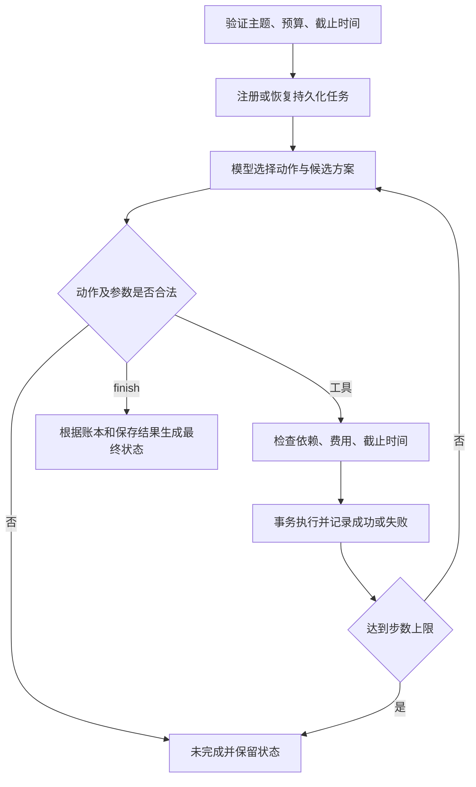

# 调用流程、动态决策与技术取舍

使用 Python 3.12 标准库、CLI 与 SQLite，不引入 Agent 框架。这样能直接检查状态、费用与事务，减少安装和框架适配成本。第 1 题的配置加载方式得到复用，本题任务状态、工具、决策提示和测试独立实现，不依赖外层项目代码。

## 模型职责

每轮向真实模型提供原始约束、候选费用表、当前步骤结果、估算、已花费用、累计耗时、上次错误和剩余步数。模型返回 action、arguments 和一句基于观察的简要依据。允许 search_materials、estimate_cost、generate_script、save_plan、finish；估算、生成和保存只接受 variant 参数，不能通过参数重写预算或截止时间。

预算 10 的真实路径先估算 premium=12，观察 budget_gap=2 后改估 lean=8，再生成和保存 lean。失败路径由模型选择重试或替代方案，程序没有自动固定重试；离线 Mock 另有确定性策略并显式标记，不能冒充真实模型决策。

## 费用与时间

| 工具或候选 | 成功费用 | 成功耗时（分钟） |
| --- | --- | --- |
| 素材检索 | 0 | 1 |
| 估算 | 0 | 0 |
| premium 脚本 | 10 | 6 |
| lean 脚本 | 6 | 3 |
| basic 脚本 | 4 | 2 |
| 保存 | 2 | 1 |

从未执行任务开始，premium 总费用 12、耗时 8 分钟；lean 为 8、5 分钟；basic 为 6、4 分钟。失败默认不收费、耗时 1 分钟。估算值是“已花费用 + 尚需步骤费用”，不是新增扣款；已生成同一候选脚本时，后续估算不再重复计算该生成成本。

生成前检查整个剩余候选方案可否完成，保存前再次按当前账本检查。候选切换不退还已花费用。完成方案被冻结，后续模型动作不能继续付费改变已保存结果。候选及费用可在 data 中查看，非法负数费用/耗时被拒绝。

## 状态、幂等与恢复

SQLite tasks 表持久化原始请求指纹、素材/费用目录指纹和任务状态；plans 表按 task_id 唯一保存最终方案。状态包含每步最新结果、全部执行事件、已花费用、累计时间、估算、选择候选和已保存方案。每个工具在 BEGIN IMMEDIATE 事务中重新加载状态并执行；同一步并发重复调用只产生一次实际成功费用。

成功检索与生成通过步骤键缓存；估算允许基于新耗时重新计算。重复完成任务直接返回原方案，不再次调用模型和工具。未完成任务恢复原状态，重试失败步骤或选择其他候选。步骤当前状态可以从失败恢复为成功，之前的失败尝试仍完整保留在 tool_results 与 Trace 中，不被改写为成功。

SQLite 写入失败会回滚当前工具事务，先前成功的脚本与费用仍保留。模型错误、提前 finish、步数耗尽都不能制造成功状态；只有真实保存结果存在且正常结束才报告 completed。步数上限发生在保存之后时，同时保留 incomplete 和 saved_plan，准确说明已经发生的副作用。

## 接入与记录

真实模型通过 HTTPS /chat/completions 接口接入，Bearer 认证，temperature=0，单请求超时 30 秒，单响应最大 1 MiB。错误只记录 HTTP 状态或异常类型，不保存响应正文、密钥或隐藏思维过程。根目录 .env 自动加载，环境变量优先；可用 --env-file 指定本机文件。

Trace 保存每步动作、工具参数、观察结果、下一动作与简要依据；独立 .trace.json 从实际输出提取。状态账本、业务时间和记录生成的真实时间分别保存，避免把模拟业务耗时当作真实 API 延迟。
